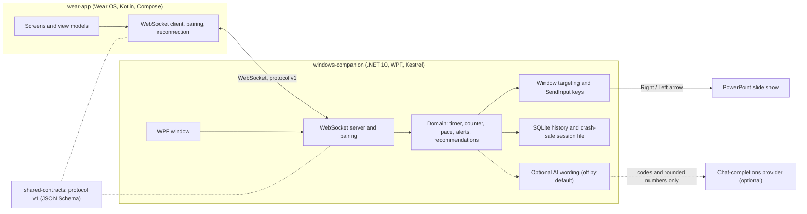

# Presenta

**Presenta** (Control Inteligente de Presentaciones) is an academic Wear OS app that controls a presentation running on a Windows PC and helps the presenter watch time, slide progress, pace and alerts. The watch sends intents (next, previous, set slide, start, pause, finish); a companion app on the PC owns the clock, the rules and the history, and presses the arrow keys in the chosen slide-show window.

## Downloads

Ready-to-run files are in [`releases/`](releases/). You do not need to build anything.

| What it is | File | Size (MiB) | Kind | SHA-256 |
|---|---|---|---|---|
| Windows companion (the PC side) | [Presenta-Companion-win-x64.zip](releases/Presenta-Companion-win-x64.zip) | 74.3 | Self-contained Windows x64 (no .NET install needed), version 1.0.0 | `612f1940e720ae47fd674a0b866596e3fcbbb5dd15d0ddda3c61b0dfcb369c74` |
| Watch app | [Presenta-Wear.apk](releases/Presenta-Wear.apk) | 37.7 | Wear OS debug APK, installs on the `Wear_OS_Large_Round` emulator | `e02ae6ba3fdbab3a05757eb9b42f55859c2356caed1c93d4467c8219ec2e845e` |
| Quick-start instructions (Spanish) | [LEEME.md](releases/LEEME.md) | less than 0.01 | Markdown text | `c7ed77e59cb8b59bb36fd49504a8e48d719a8a21be12df9b258f7326dcc3a075` |
| Hashes of the two downloads | [SHA256SUMS.txt](releases/SHA256SUMS.txt) | less than 0.01 | Text, `<hash>  <file>` lines | `1439b4a2944940ae12e20bdea118953632ad263885d468e779e388983ebccd73` |

**Windows companion**

1. Unzip `Presenta-Companion-win-x64.zip` into a folder of your own. It creates the folder `Presenta-Companion`.
2. Inside it, run `Iniciar-Presenta.ps1` (right-click, Run with PowerShell; or `powershell -ExecutionPolicy Bypass -File .\Iniciar-Presenta.ps1`). It reads an optional `.env` next to it and starts the app. You can also start `Presenta.exe` directly, without the AI.
3. The window opens and shows the pairing code; "Servidor activo" means the PC is ready for the watch.

**Watch app (emulator)**

1. Start the `Wear_OS_Large_Round` emulator from Android Studio and wait until it has booted.
2. Install the APK: `& "<ANDROID-SDK-PATH>\platform-tools\adb.exe" install -r Presenta-Wear.apk` (replace `<ANDROID-SDK-PATH>` with the folder of your Android SDK), or drag the file onto the emulator window.
3. Open Presenta on the watch and type the six-digit code shown by the companion.

To check a download, run `Get-FileHash -Algorithm SHA256 .\releases\<file>` in PowerShell and compare the result with the table or with `releases/SHA256SUMS.txt`.

Instructions in Spanish: [releases/LEEME.md](releases/LEEME.md). How the files are built and checked: [docs/delivery/release.md](docs/delivery/release.md).

The same files are also published as a repository release:

Release page: <https://github.com/Juls2212/Presenta/releases/tag/v1.0.0>

It is developed and tested with Android Studio and the Wear OS emulator next to PowerPoint on Windows 11. A physical watch on the local network is designed for but **not supported yet** (see Known limitations).

## Architecture in one diagram



It is a **modular monolith** in one repository with a clear frontend/backend separation, not a microservice system. Details: [docs/architecture.md](docs/architecture.md) and [docs/decisions.md](docs/decisions.md) (ADR-01 to ADR-83).

## Features

- **Pairing** with a six-digit code shown by the companion (optionally remembered across restarts), lockout after repeated wrong codes, one watch at a time, one companion instance.
- **Slide control:** next and previous on the main screen, a slide counter with manual correction that presses no key, keys sent only to the chosen slide-show window (chosen automatically when exactly one PowerPoint show is open), with a "Verificar" check and a diagnostic report when a key cannot be delivered.
- **Session:** configure slides and minutes on the watch, start, pause by long press, finish by swipe up with confirmation; the PC owns the authoritative clock and the watch interpolates between snapshots.
- **Pace, alerts and recommendations:** deterministic rules (warm-up, behind schedule, too fast, time running out, critical, overtime, with cooldown and acknowledgment) and short recommendation texts; visual alerts plus four haptic patterns (verifiable in Logcat on the emulator).
- **History:** every finished or interrupted session is saved automatically on the PC (SQLite) and listed on the watch, newest first, with "Hoy" and "Ayer" dates; a running session survives a companion crash and is saved once as interrupted at the next start.
- **Connection resilience:** the watch shows "Reconectando…" and never gives up while a session runs; the PC keeps the session during a grace period.
- **Optional AI wording** (off by default, needs your own provider and key): a one-sentence Spanish tip in the alert pill. It never decides pace, alerts or timing, receives only codes and rounded numbers, and every failure falls back to the usual wording.
- **Desktop companion window:** a navigation rail with six pages, a checklist on Inicio (watch, window, keys, AI), the pairing digits and diagram, the window list grouped by relevance, a didactic timeline of the alerts, design tokens with checked contrast, and an application icon (see [docs/ui-direction.md](docs/ui-direction.md)).
- **Delivery kit:** automated verification, a manual validation guide, a 10-minute smoke test, a demo script, a preflight script and an accessibility report (see Documentation).

## Requirements coverage

How far each requirement is proven. **A** = proven by the automated tests that run by default (`verify-all.ps1`). **O** = also proven by opt-in tests (cross-stack, which runs the real watch client against the real server, or desktop, which uses real windows and keys in helper programs). **M** = awaiting your manual validation (rows of [docs/validation/validation-guide.md](docs/validation/validation-guide.md); the 10-minute subset is [docs/validation/smoke-test.md](docs/validation/smoke-test.md)). "Awaiting M" means nothing has been run by hand yet; no manual result exists in this repository.

| Code | Requirement | Status | What is proven, and what is open |
|---|---|---|---|
| RF 01 | Connect watch and Windows app over LAN | **A + O**, awaiting M | A real WebSocket client pairs with the real server on loopback (server tests; Kotlin client against the real server). Open: the emulator path through `10.0.2.2`, the firewall, and a **physical watch on a LAN address (not supported yet)**. M: rows 1 to 5, 99. |
| RF 02 | Visible connection state | **A + O**, awaiting M | Connected, reconnecting and disconnected states follow the connection. M: rows 6, 7, 97, 98. |
| RF 03 | Configure slides and duration | **A**, awaiting M | Limits 1 to 200 slides, 1 to 180 minutes, defaults 20 and 15. M: rows 8, 69. |
| RF 04 | Start once connected | **A + O**, awaiting M | Start refused clearly without a usable target window. M: rows 8, 31, 40. |
| RF 05 | Next slide | **A + O**, awaiting M | A key is sent only when the counter changes, only to the chosen window, with the foreground rule; real windows and keys in helper programs (desktop tests). **Real PowerPoint not run.** M: rows 9, 30 to 42, 86 to 92. |
| RF 06 | Previous slide | **A + O**, awaiting M | Same as RF 05. M: rows 10, 12, 30 to 42. |
| RF 07 | Counter and manual correction | **A + O**, awaiting M | `slide.set` never presses a key; range errors. M: rows 13, 14, 38. |
| RF 08 | Start, pause, finish | **A + O**, awaiting M | All transitions over the socket and on the watch. M: rows 15, 18, 19. |
| RF 09 | Elapsed and remaining time | **A**, awaiting M | Pause excluded, negative in overtime, interpolation between snapshots on virtual time. Clock accuracy against a stopwatch is M: row 71. |
| RF 10 | Visual and haptic alerts | **A + O**, awaiting M | The exact second of every alert for three example plans is asserted; the real watch client sees every alert kind from the real server running faster; one haptic pattern per new alert through a recording player. **Real vibration needs a physical watch.** M: rows 43 to 61. |
| RF 11 | Pace and recommendation | **A + O**, awaiting M | Codes and wording from the companion. The optional AI wording is proven against a local stand-in and a fake client only: **no real provider was called**. M: rows 72, 100 to 108. |
| RF 12 | Finish and summary | **A + O**, awaiting M | Finish, paused finish, interruption, closing the companion during a session. M: rows 18 to 20, 65 to 68, 93. |
| RF 13 | Stored data | **A** | Planned and actual duration, slides, average pace and final state in a real SQLite file, across reopening. M: rows 19, 74. |
| RF 14 | List finished presentations | **A + O**, awaiting M | Newest first, empty state, dates "Hoy", "Ayer", "08 Oct". M: rows 21, 22, 74 to 79. |
| RF 15 | Clear messages, session not closed on failure | **A + O**, awaiting M | A failed key or command leaves the session running; every error has a Spanish message; the watch never gives up during a session. M: rows 23 to 26, 35, 40, 75, 97, 98. |
| RNF 01 | Controls without navigation | **A**, awaiting M | Next and Previous stay on the main screen, also during alerts. Feel is M: rows 9, 16. |
| RNF 02 | Short text, contrast, round screen | **A**, awaiting M | Contrast at least 4.5:1 for all pairs; layouts on two round sizes at font scales 1.0 and 1.3 (JVM). **No real device, no real TalkBack.** See [docs/validation/accessibility-report.md](docs/validation/accessibility-report.md). M: rows 82, 83, V1 to V12. |
| RNF 03 | Command within about 2 s | **O** (loopback only), awaiting M | Median 0.8 ms and p95 1.6 ms over loopback with a developer host that presses no key. The real number with PowerPoint is M: rows 27, 42. |
| RNF 04 | Connection state within 5 s | **A + O**, awaiting M | At most 3.5 s on virtual time with the production constants (also at the worst alignment); a killed host noticed in milliseconds. M: rows 6, 28, 29. |
| RNF 05 | Windows 10 and 11 | Windows 11 **A**; **Windows 10 not verified** | Built and tested on Windows 11. Only documented Win32 calls are used. M: row 84 (needs a Windows 10 computer). |
| RNF 06 | History persists across restarts | **A**, awaiting M | SQLite across restart, remembered code, crash recovery exactly once. M: rows 76, 93, 94. |
| RNF 07 | LAN only, nothing sensitive | **A**, awaiting M | Loopback by default, cleartext only to three hosts on the watch, pairing code never logged, the AI sends only codes and rounded numbers and keeps the key out of every log. M: rows 80, 81, 106. |
| RNF 08 | Consistent states | **A**, awaiting M | All 26 states rendered on both sizes with one design system. Visual review is M: V2 to V4. |

Acceptance criteria AC1 to AC7 of the prototype map to rows in section 8 of the validation guide.

## Tests at a glance

Last full run (`./scripts/verify-all.ps1 -CrossStack`, see [docs/validation/automated-run-latest.md](docs/validation/automated-run-latest.md) for the current numbers):

| Suite | Result |
|---|---|
| Companion (`dotnet test`) | 1138 pass, 12 skipped (the opt-in desktop tests and the picture export) |
| Watch unit tests (Gradle, JVM and Robolectric) | 270 pass |
| Watch lint | 0 errors |
| Cross-stack (real watch client, real server) | 13 pass |
| Spanish strings quoted in the guides | all exist in the resource files |

## Build, test and run

### Companion (needs the .NET 10 SDK)

```
dotnet build windows-companion/Presenta.Companion.sln -warnaserror
dotnet test windows-companion/Presenta.Companion.sln
dotnet run --project windows-companion/src/Presenta.Companion.App
```

The window has a left rail with six pages (Inicio, Vincular, Ventana, IA y alertas, Actividad, Configuración): the pairing code, the server status, the choice of the presentation window and the optional AI are on their own pages. Only one companion runs at a time.

### Watch app (needs JDK 21 and the Android SDK; see [wear-app/README.md](wear-app/README.md))

```
cd wear-app
gradlew.bat :app:assembleDebug :app:testDebugUnitTest :app:lintDebug
gradlew.bat :app:crossStackTest    # optional: real watch client against the real server
```

To run it, open the `wear-app` folder in Android Studio, start the `Wear_OS_Large_Round` emulator and press Run on the `app` configuration. Setup and troubleshooting: [docs/manual-test-guide.md](docs/manual-test-guide.md).

### Everything at once

```
./scripts/verify-all.ps1 -CrossStack          # build, tests, lint, cross-stack; writes docs/validation/automated-run-latest.md
./scripts/verify-all.ps1 -CrossStack -Desktop # also the desktop tests: small windows open and arrow keys are pressed into them
./scripts/check-guide-strings.ps1             # Spanish text quoted in the guides must exist in the resource files
./scripts/demo-preflight.ps1                  # read-only checklist before a demo (tools, AVD, port, AI variables)
./scripts/run-companion.ps1                   # starts the companion with the variables of a local .env file
```

## Enable the AI (optional)

Off by default; the product works the same without it. You need a chat-completions provider and your own key.

1. Copy `.env.example` to `.env` (ignored by Git) and put your key after `PRESENTA_AI_API_KEY=`. The example is set for an OpenAI account; pick a small non-reasoning chat model.
2. Start with `./scripts/run-companion.ps1`. It loads the `PRESENTA_*` values for that run only and never prints them.
3. In the companion window turn on "Usar IA para redactar las recomendaciones".

The optional request settings, the automatic adjustment when a provider rejects a parameter, and what is sent are in [windows-companion/README.md](windows-companion/README.md) ("Enable the AI"). No real provider has been called by the automated tests.

## Repository layout

| Folder | Purpose |
|---|---|
| `wear-app/` | Wear OS frontend (Kotlin, Jetpack Compose for Wear OS, Wear Material 3, DataStore). |
| `windows-companion/` | Windows backend and desktop UI (C#, .NET 10, WPF, Kestrel WebSocket server, SQLite history, window targeting, optional AI library, a developer host). |
| `shared-contracts/` | Language-neutral protocol v1: JSON Schemas, examples and `protocol-v1.md`. |
| `docs/` | Architecture, decisions, roadmap, UI direction, traceability, testing, environment; `docs/validation/` (guide, smoke test, accessibility report, latest automated run); `docs/delivery/` (demo script); `docs/ui-previews/` (rendered screens); `docs/mockups/`. |
| `scripts/` | `verify-all.ps1`, `check-guide-strings.ps1`, `run-companion.ps1`, `demo-preflight.ps1`. |

`.env.example` at the root lists the AI variables.

## Documentation

- [Architecture](docs/architecture.md) and [Decisions (ADRs)](docs/decisions.md)
- [Roadmap and real final state](docs/roadmap.md)
- [Requirements traceability](docs/requirements-traceability.md) and [Testing strategy](docs/testing-strategy.md)
- [Validation guide](docs/validation/validation-guide.md) (all manual tests), [Smoke test](docs/validation/smoke-test.md) (10 minutes), [Accessibility report](docs/validation/accessibility-report.md), [Latest automated run](docs/validation/automated-run-latest.md)
- [Demo script](docs/delivery/demo-script.md) (about 6 minutes, emulator only) and [Release artifacts](docs/delivery/release.md)
- [Manual test setup and troubleshooting](docs/manual-test-guide.md), [Environment](docs/environment.md)
- [UI direction](docs/ui-direction.md) and [Mockups](docs/mockups/README.md)
- [Protocol v1](shared-contracts/protocol-v1.md), [companion README](windows-companion/README.md), [watch README](wear-app/README.md)

## Known limitations

- **No manual result exists yet.** Everything marked "awaiting M" above is unrun by a person. The 10-minute smoke test is the minimum.
- **Physical watch over a LAN is not supported:** the watch allows cleartext only to `10.0.2.2`, `localhost` and `127.0.0.1`, and has no screen to edit the address (deferred).
- **Real vibration** cannot be felt on the emulator (Logcat lines only); **real TalkBack** and a real device were not used.
- **Windows 10** was not tried; only Windows 11.
- **PowerPoint was not run by any automated check.** Keys are proven against helper windows in separate processes; full-screen shows, several monitors, administrator windows and browsers (Google Slides, Canva, identified by title only) are not covered.
- **No real AI provider** was called; the request shape follows the documented chat-completions convention and is proven against a local stand-in.
- **Latency with real key injection** (RNF 03) is unmeasured; the loopback numbers do not include the slideshow repaint.
- Out of scope for version 1: direct PowerPoint, Canva or Google Slides APIs, slide content analysis, mouse control, gestures, cloud accounts, a phone intermediary and dashboards.
