# Architecture

## Overview

Presenta is a **modular monolith** kept in one repository with a clear frontend/backend separation. It is not a microservice system.

- `wear-app/` is the Wear OS frontend. It owns screens, navigation, UI state, and view models. It never touches Windows keyboard APIs or OS automation.
- `windows-companion/` is the Windows backend plus desktop UI. It owns the WebSocket server, connection state, pairing, session business logic, keyboard simulation, and history.
- `shared-contracts/` holds language-neutral protocol specs (JSON Schema + Markdown). Each side keeps its own models.

## Boundary rules

1. The watch and the companion communicate only through the v1 protocol defined in `shared-contracts/`.
2. The watch never sends keystrokes or OS commands; it sends intent messages (for example `slide.next`).
3. The companion's domain layer is the single authority for the timer, slide counter, pace, alerts, and recommendations.
4. The domain and protocol return structured data (codes and numeric parameters). Localization lives only in the UI layers (watch resources, WPF resource file).
5. Keyboard simulation sits behind an interface; the domain never references `SendInput` directly.
6. Recommendations sit behind `IRecommendationProvider`; V1 ships only the rule-based provider.
7. Server, domain, protocol, and persistence code contain no Spanish text.
8. Keys are sent only when the domain reports that the slide counter actually changed. `slide.set` never sends keys.

## Component diagram

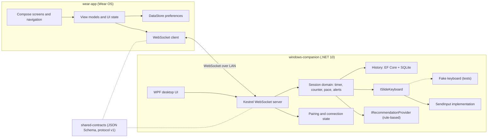

## Sequence: connect and pair

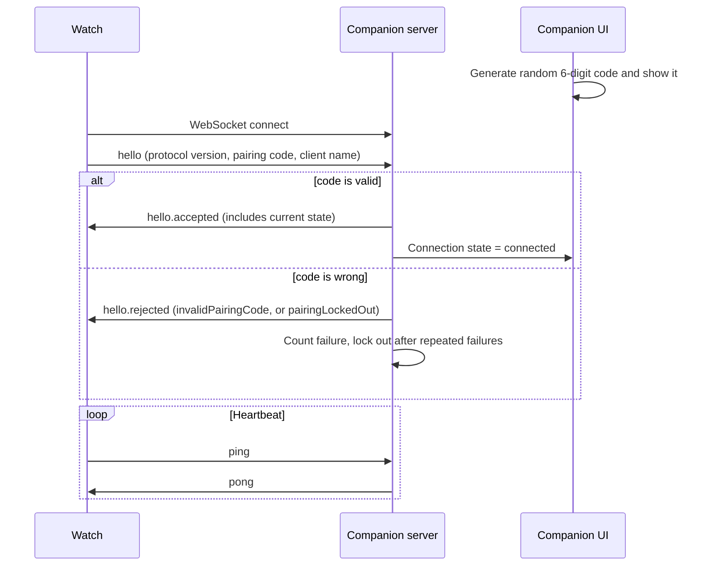

## Sequence: start session

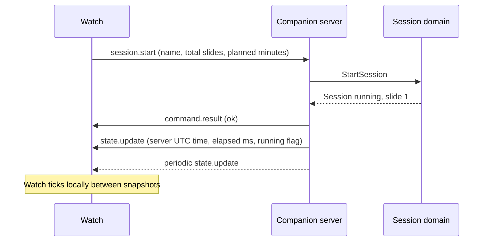

## Sequence: next and previous slide

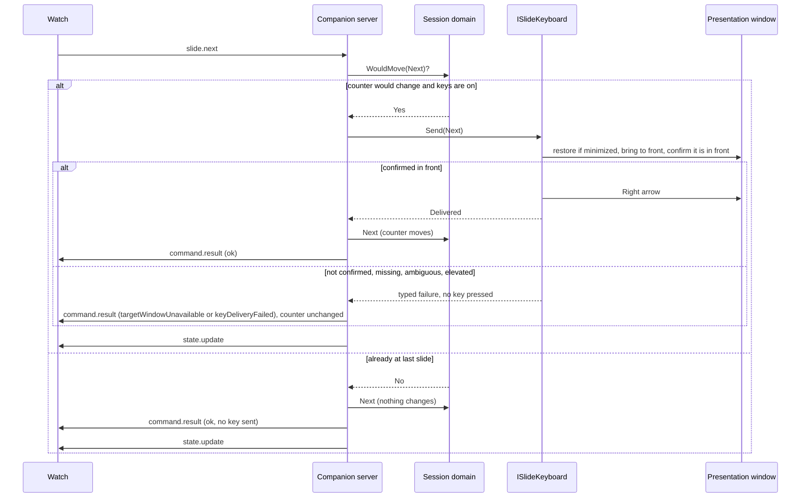

`slide.previous` follows the same flow with the Left arrow. `slide.set` updates the counter and sends no key. With "send keys" off the counter simply moves. The key goes first and the counter second, so a failed delivery never leaves the counter ahead of the slideshow (ADR-58).

### Presentation window targeting (Phase 5.1)

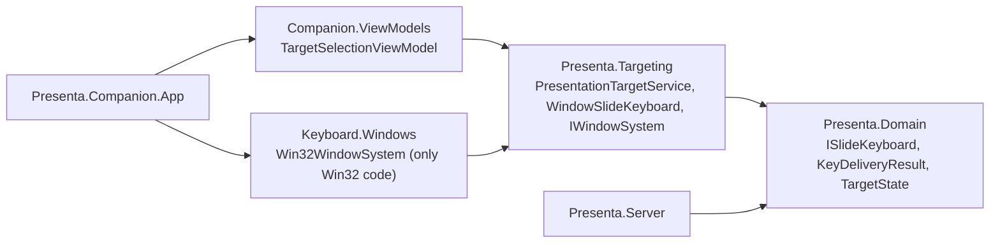

Per key, `WindowSlideKeyboard` resolves the saved identity to a live window, restores it if minimized, brings it to the front unless it already is, confirms it is the foreground window (3 attempts of up to 250 ms), checks again right before the press, and only then presses Right or Left. Any failure returns a typed result and presses nothing (ADR-54 to ADR-59).

## Sequence: alert

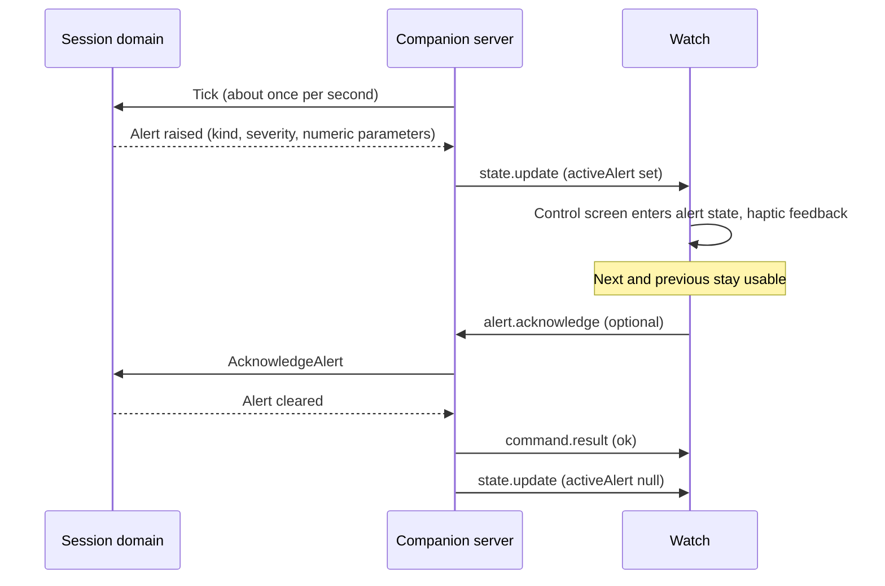

## Sequence: finish, auto-save, summary

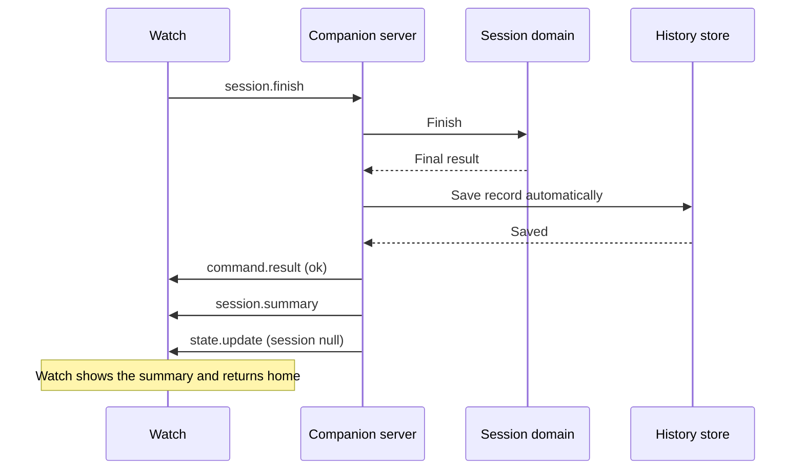

The same auto-save and `session.summary` flow runs when a session ends while paused or is interrupted by disconnection. There is no save command.

## Sequence: history

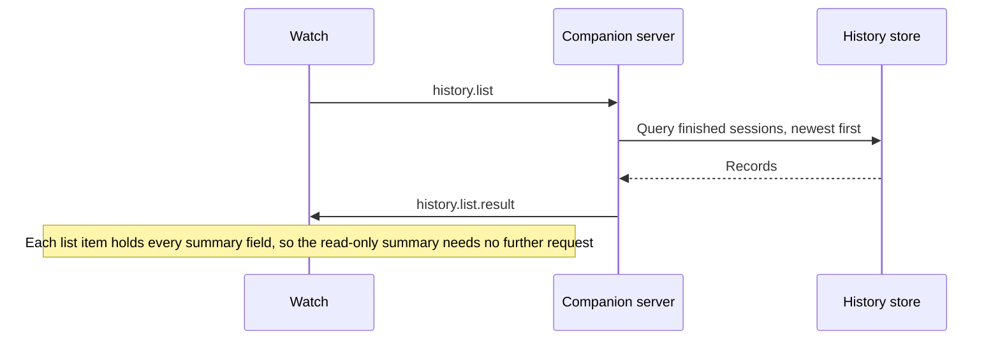

## Sequence: disconnection and reconnection

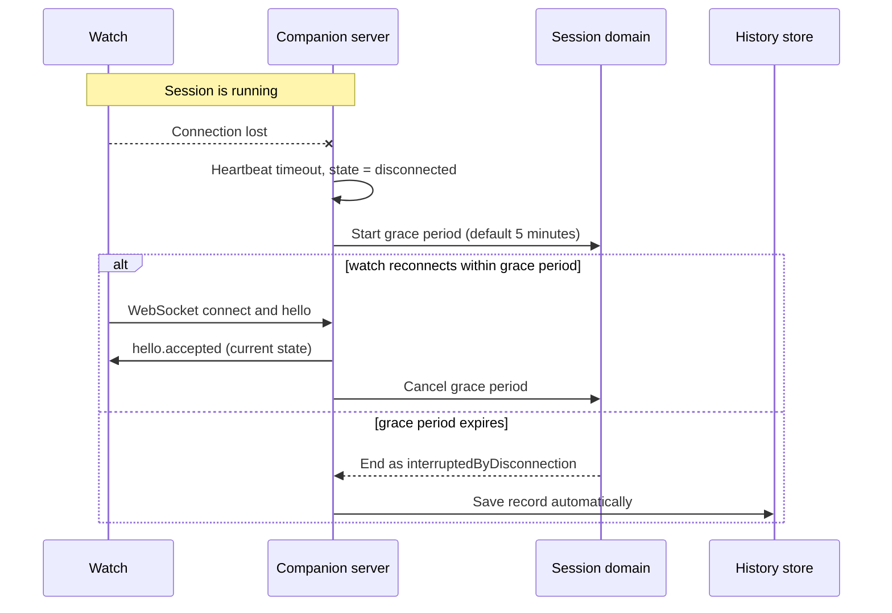

Only one watch connection exists at a time. A new valid connection replaces the old one.

## Connection topology

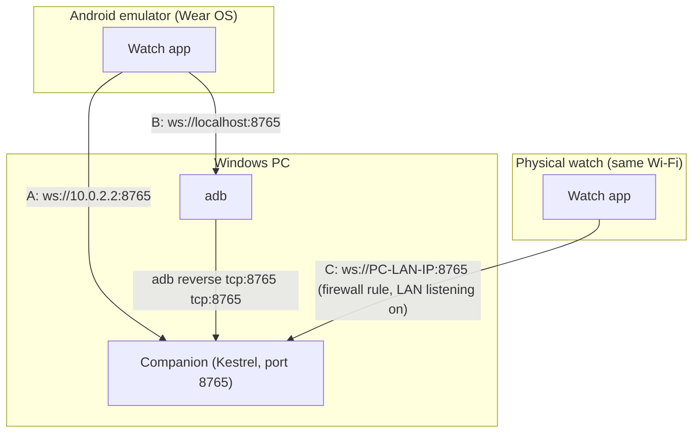

- **A, emulator via `10.0.2.2`:** default. The emulator's alias for the host loopback.
- **B, emulator via `adb reverse`:** fallback. `adb reverse tcp:8765 tcp:8765`, then use `ws://localhost:8765`.
- **C, physical watch via LAN:** the companion must allow the local network (default is loopback-only) and Windows Firewall must permit the port.

## Implemented structure (Phase 4)

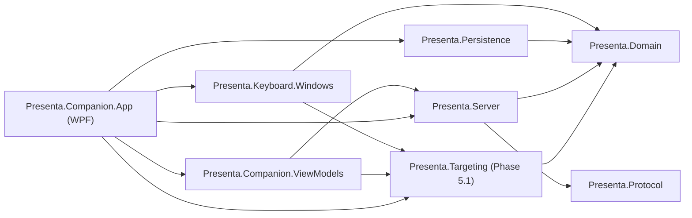

- `Presenta.Server` contains `CompanionService` (all logic, one gate that serializes commands, ticks, heartbeats and disconnects) and `CompanionHost` (Kestrel). The service outlives the listener, so rebinding the address does not lose the session.
- Dependencies point inward: the domain knows nothing about sockets, SQLite, or Windows. `ISlideKeyboard` and `IHistoryStore` are defined in the domain. The app uses `WindowSlideKeyboard` (in `Presenta.Targeting`) as the keyboard; the Win32 calls are in `Presenta.Keyboard.Windows`; history is in `Presenta.Persistence`.
- A single `TimeProvider` timer ticks once per second: it ticks the domain, closes silent connections, ends a session whose watch has not returned within the grace period, and sends a `state.update` every 5 seconds while a watch is connected.
- Message names in the diagrams above are the final protocol v1 names (`hello.accepted`, `state.update`, `command.result`, `session.summary`, `history.list.result`).
- Sequence of a session end: `command.result`, then `session.summary`, then `state.update` with `session: null`. After an interruption nothing is sent; the record is found through `history.list`.

## Watch client (Phase 5)

`RemotePresentaRepository` is the only class that knows about sockets and protocol messages. It implements the same `PresentaRepository` interface as the fake, so no screen changes. All its state changes happen in one coroutine that processes socket callbacks, commands, and a 0.5-second tick one at a time.

### Connection states

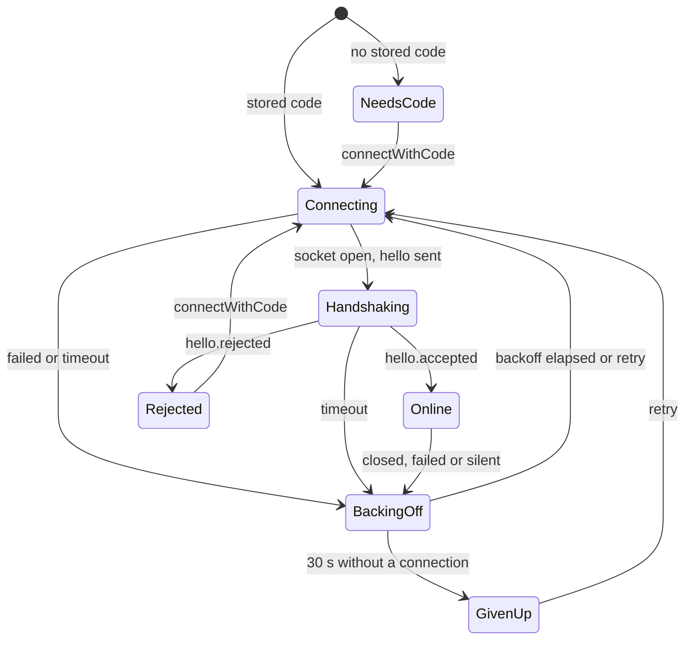

What the screens see: `Online` is "Connected" and "Paired"; `Connecting`, `Handshaking`, and `BackingOff` are "Reconnecting"; `GivenUp` is "Disconnected" (screen 07); `NeedsCode` and `Rejected` bring up the pairing screen.

### Connect, heartbeat, loss, and reconnection

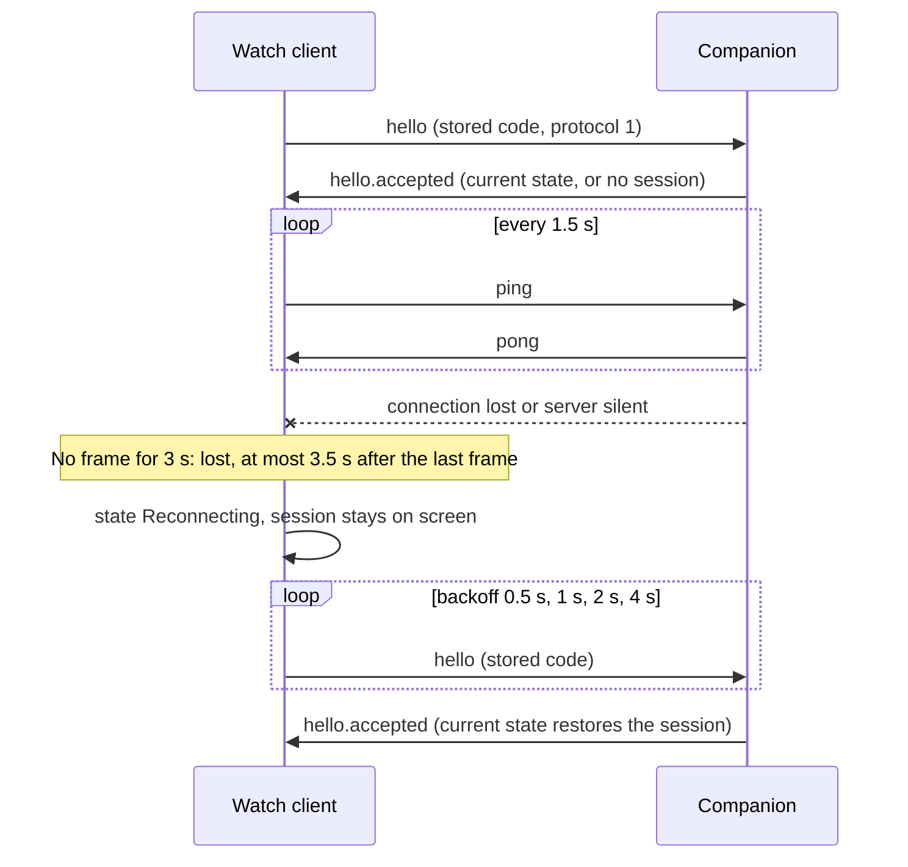

- The pairing code is the one stored on the watch; a wrong or outdated code ends the loop and shows the pairing screen.
- Commands are sent only when online. Otherwise they fail immediately; nothing is queued.
- Every `state.update` replaces the session and re-synchronizes the local clock that interpolates elapsed time between updates.
- `session.summary` becomes an event for the summary screen; `history.list` waits for `history.list.result`.
